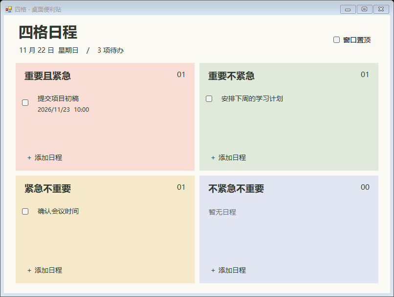

# 四格日程 · Four-Quadrant Sticky Notes

四格日程是一款 Windows 桌面便利贴。它按重要性和紧急程度把待办分成四格，让你一眼看到哪些事需要马上处理，哪些值得留出时间慢慢做。
由chatgpt生成


## 使用方法

1. 在对应象限点击 **＋ 添加日程**，输入事项。需要指定日期和时间时，勾选 **安排时间**，选好后点击 **保存**。
2. 完成一件事后，勾选它左侧的方框。点一下事项名称，可以修改内容、调整时间、更换象限或删除事项。
3. 想边工作边看待办时，勾选右上角的 **窗口置顶**，便利贴就会显示在其他窗口前面。

## 在 Windows 上运行

已有程序时，双击 `四格日程.exe` 即可打开。如果从 GitHub 下载的是源码，先解压文件，在包含 `Board.cs` 的文件夹里打开 PowerShell，运行以下命令编译并启动：

```powershell
$csc = "$env:WINDIR\Microsoft.NET\Framework\v4.0.30319\csc.exe"
& $csc /nologo /target:winexe /codepage:65001 /out:四格日程.exe Board.cs
if ($LASTEXITCODE -eq 0) { .\四格日程.exe }
```

程序使用 C# 和 Windows Forms 编写，以上命令使用 .NET Framework 4.x 的 C# 编译器。编译一次后，以后直接双击程序即可。

## 日程保存在哪里？

日程会自动写入程序同目录下的 `四格日程.xml`。跨天、关闭程序或重启电脑后，待办和完成状态都会保留。换电脑时，把这个文件和 `四格日程.exe` 一起复制过去，就能接着用。
# four-quadrant-sticky-notes
four-quadrant-sticky-notes
